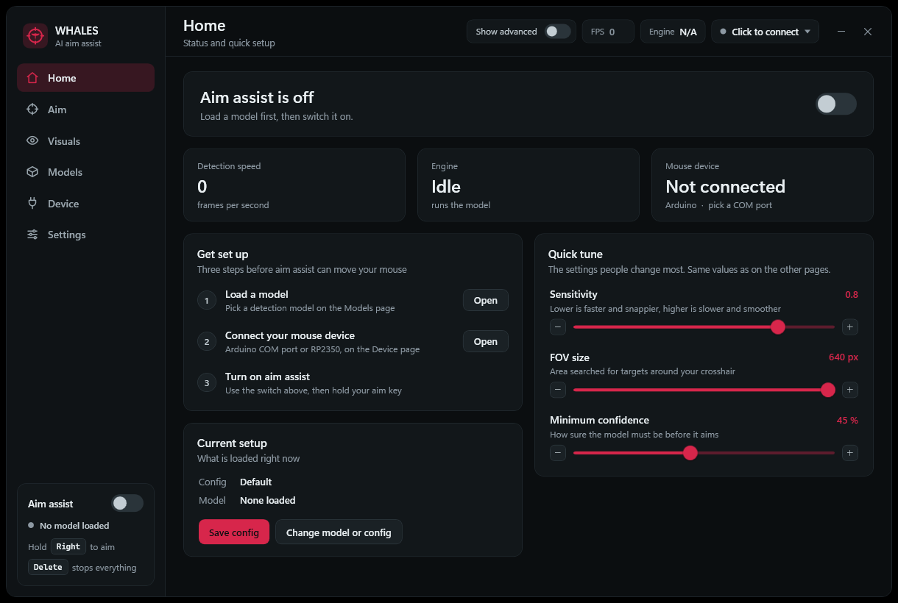
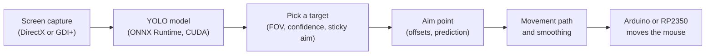
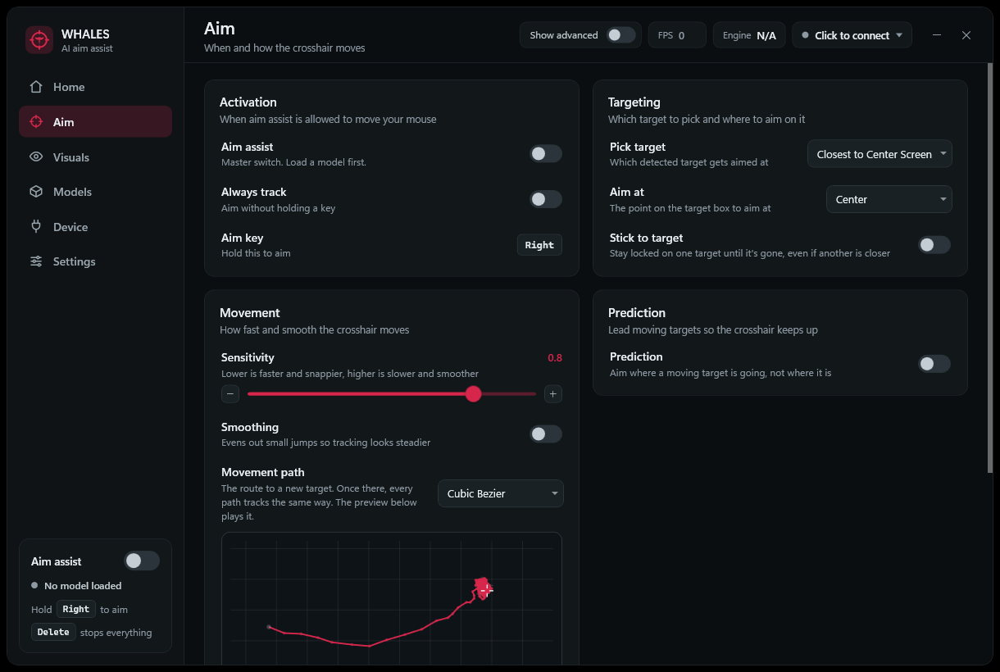
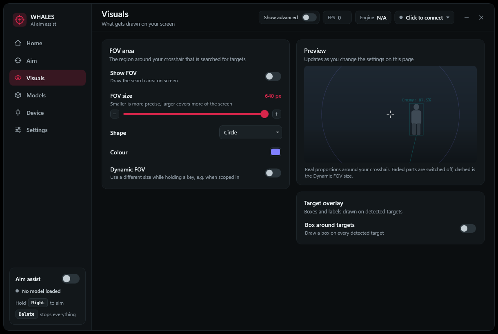
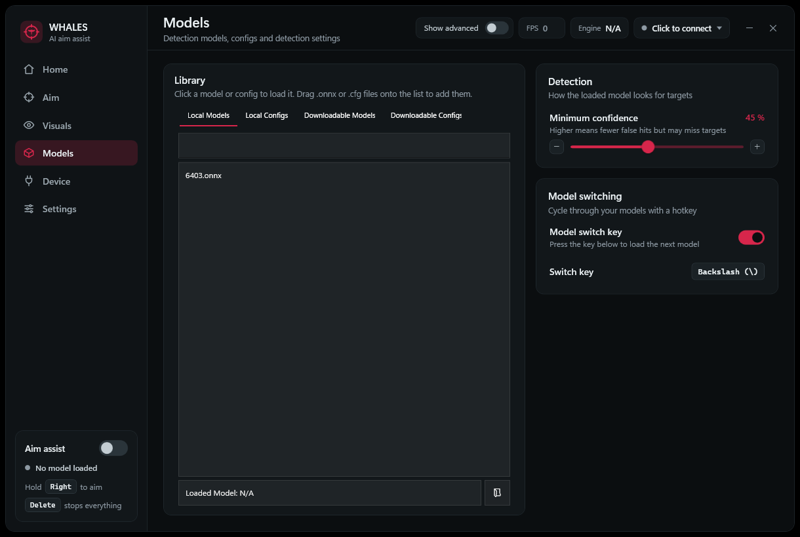

<p align="center">
  
</p>

<h1 align="center">Whales</h1>

<p align="center">
  AI aim assist for Windows, with <b>NVIDIA CUDA</b> detection and <b>Arduino / RP2350</b> hardware mouse output.<br>
  A fork of <a href="https://github.com/Babyhamsta/Aimmy">Aimmy 2.5.0</a>.
</p>

<p align="center">
  <a href="https://github.com/DEORA2/AIMMY-2.5.0-ARDUINO-CUDA/releases/latest"><b>Download the latest release</b></a>
</p>



> [!NOTE]
> **Whales is a fork of [Aimmy](https://github.com/Babyhamsta/Aimmy)**, made by Babyhamsta, MarsQQ and Taylor. All the original work, ideas and credit belong to them and the Aimmy contributors (see [Credits](#credits)). This fork adds CUDA, hardware mouse devices, a new interface and reworked aiming. It is not made or supported by the Aimmy team, so please don't ask them for help with it.

## Contents

- [About Aimmy](#about-aimmy)
- [What this fork adds](#what-this-fork-adds)
- [How it works](#how-it-works)
- [Requirements](#requirements)
- [Install and first run](#install-and-first-run)
- [Every option explained](#every-option-explained)
  - [Header and sidebar](#header-and-sidebar)
  - [Home](#home)
  - [Aim](#aim)
  - [Movement paths](#movement-paths)
  - [Visuals](#visuals)
  - [Models](#models)
  - [Device](#device)
  - [Settings](#settings)
- [Supported models](#supported-models)
- [Files and folders](#files-and-folders)
- [Troubleshooting](#troubleshooting)
- [Building from source](#building-from-source)
- [Credits](#credits)
- [License](#license)

## About Aimmy

[Aimmy](https://github.com/Babyhamsta/Aimmy) is a free, AI-based aim alignment tool developed by **Babyhamsta, MarsQQ and Taylor**, made to help gamers who have difficulty aiming. It runs a YOLO object-detection model on your screen and moves the mouse toward detected players. It has no ads, no keys and no paid features.

Aimmy is **source-available, not open source**: it is licensed under PolyForm Noncommercial, which means it (and forks like this one) may never be sold or used commercially. See [SourceAvailable.md](SourceAvailable.md).

Aimmy's website is [aimmy.dev](https://aimmy.dev/) and its Discord is [discord.gg/aimmy](https://discord.gg/aimmy).

## What this fork adds

| Area | What's different from Aimmy 2.5.0 |
|---|---|
| **Detection engine** | Runs on **NVIDIA CUDA** through ONNX Runtime GPU instead of DirectML, with **CUDA graphs** when the model supports them (about 40% faster per frame in testing). Falls back to the CPU if CUDA isn't available. |
| **Mouse output** | Moves the mouse through an **Arduino** (with a USB Host Shield) over a COM port, or an **RP2350** board as a USB HID device. Movement comes from real hardware, not Windows' software input. |
| **Interface** | A new sidebar layout: Home, Aim, Visuals, Models, Device and Settings pages, live status chips, a quick-tune panel and a **Show advanced** switch that hides settings most people never touch. |
| **Movement paths** | 18 paths for how the crosshair travels to a new target, each with a live preview on the Aim page. |
| **Aiming** | Reworked tracking: frame-rate independent speed, lead for moving targets, sub-pixel accuracy, and an overshoot brake that stops the aim from swinging past targets. |
| **Sticky aim** | Rewritten. It follows the same target between frames, holds on through brief detection drop-outs, and only switches when you move your crosshair onto another target. |
| **Models** | Image sizes from 160 to 1024 px, and support for YOLOv5 to v12 output formats (see [Supported models](#supported-models)). |
| **Memory** | Lower RAM use: memory-hungry options are turned off, and the libraries ship as normal DLLs instead of being packed into the exe. |
## How it works



While you hold your aim key, Whales captures a square around your crosshair, runs it through the model, picks a target inside your FOV, works out where on the target to aim, and sends a small mouse movement to your device. This repeats every frame, usually hundreds of times a second.

## Requirements

- **Windows 10 or 11, 64-bit.**
- **[.NET 8 Desktop Runtime (x64)](https://dotnet.microsoft.com/en-us/download/dotnet/8.0)** and the **[Visual C++ Redistributable (x64)](https://aka.ms/vs/17/release/vc_redist.x64.exe)**.
- **An NVIDIA GPU** with the **CUDA 12** runtime and **cuDNN 9** installed and on your `PATH`. Without them Whales still runs, but on the CPU, which is much slower.
- **A mouse device** for aim assist to move your mouse:
  - **Arduino** (e.g. a Leonardo) with a **USB Host Shield**. Use [sketcher.raggy.cc](https://sketcher.raggy.cc/) to set up and flash the sketch.
  - Or an **RP2350** board running compatible HID mouse firmware.

  Without a device, the detection and overlays still work, but the mouse won't move.

## Install and first run

1. Download `Whales-vX.X.X-Debug-x64.zip` from [Releases](https://github.com/DEORA2/AIMMY-2.5.0-ARDUINO-CUDA/releases/latest) (not the "Source code" zip).
2. Extract the **whole** zip to a normal folder. The DLLs and the `runtimes` folder must stay next to the exe.
3. Run `WhaleCumOrganizer.exe`.
4. Follow the **Get set up** steps on the Home page:
   1. **Load a model:** on the Models page, drag an `.onnx` file onto the library or download one, then click it.
   2. **Connect your mouse device:** on the Device page, or by clicking the port chip at the top right.
   3. **Turn on aim assist** with the switch, then hold your aim key (right mouse button by default).

Press **Delete** at any time to stop everything. Press it again to turn aim assist back on.

From v2.5.6 on, Whales updates itself: it offers new releases when it starts, or when you click **Check for Updates** in Settings, and keeps your models and settings. When updating by hand, copy your old `bin` folder next to the new exe to keep them.

## Every option explained

Options marked **(advanced)** only appear when **Show advanced** is switched on in the header.

### Header and sidebar

| Item | What it does |
|---|---|
| **Sidebar pages** | Switch between pages. **Ctrl+Tab** and **Ctrl+Shift+Tab** cycle through them. |
| **Aim assist switch** (bottom of the sidebar) | The master switch, also shown on Home and Aim. Below it you see the model status, your aim key and your emergency stop key. |
| **Show advanced** | Shows or hides the advanced settings on every page. |
| **FPS** | How many frames the model is processing per second. It reads 0 while you aren't aiming. |
| **Engine** | What is running the model: **CUDA** or **CPU**. When a model loads, a notice also says whether CUDA graphs (the fastest mode) are in use. |
| **Port chip** | Shows whether your Arduino is connected. Click it to pick a COM port and connect or disconnect. |

### Home

| Item | What it does |
|---|---|
| **Aim assist** | Big on/off switch, with a line telling you what is still missing (e.g. no model loaded). |
| **Detection speed / Engine / Mouse device** | Live status: frames per second, what's running the model, and whether your device is connected. |
| **Get set up** | The three steps needed before aim assist can move your mouse, ticked off as you complete them. **Open** takes you to the right page. |
| **Current setup** | The config and model that are loaded. **Save config** saves your settings, **Change model or config** opens the Models page. |
| **Quick tune** | Sensitivity, FOV size and minimum confidence. These are the same settings as on the other pages, placed here because they're changed the most. |

### Aim



**Activation**

| Option | What it does |
|---|---|
| **Aim assist** | Master switch. Needs a model loaded first. |
| **Always track** | Aims all the time, without holding the aim key. |
| **Aim key** | Hold this to aim. Click it, then press any key or mouse button to change it. Default: right mouse button. |
| **Second aim key** (advanced) | A second key that also aims. |

**Movement**

| Option | What it does |
|---|---|
| **Sensitivity** | How quickly the crosshair moves onto the target. **Lower is faster and snappier, higher is slower and smoother.** Very high values (0.98+) may stop it reaching targets; very low values (0.1 or less) can make it unstable. |
| **Smoothing** | Averages each movement with the previous one, so tracking looks steadier. |
| **Smoothing amount** | Shown when Smoothing is on. Lower is smoother but slower to react. |
| **Jitter** (advanced) | Adds random movement of up to this many pixels each frame, so aim looks less robotic. 0 turns it off. |
| **Movement path** | The route the crosshair takes to a new target. Once it reaches the target, every path tracks it the same way. The preview underneath plays the chosen path. See [Movement paths](#movement-paths). |

**Auto trigger**

| Option | What it does |
|---|---|
| **Auto trigger** | Clicks for you while you hold the aim key and a target is detected. |
| **Only when on target** | Only fires when your crosshair is inside the target's box. |
| **Spray mode** | Holds the mouse button down instead of clicking, for automatic weapons. |
| **Delay** | How long to wait after a target appears before firing, in seconds. |

**Targeting**

| Option | What it does |
|---|---|
| **Pick target** | Which target gets aimed at when several are detected: **Closest to Center Screen** or **Closest to Mouse**. |
| **Aim at** | The point on the target's box to aim at: **Center**, **Top** (head area) or **Bottom**. |
| **Stick to target** | Stays locked on one target until it's gone, even if another one is closer. It keeps hold of the target through short detection drop-outs (blur, partly hidden), and briefly pauses the aim instead of guessing. |
| **Switch radius** | Shown when Stick to target is on. Switches to another target only when you put your crosshair within this many pixels of it. **0 means never switch** while your current target is visible. |
| **Third-person games** (advanced) | Adjusts the detection area for third-person cameras, so your own character isn't targeted. |
| **Vertical offset in %** (advanced) | Uses a percentage of the box height for the vertical offset, instead of pixels. |
| **Vertical offset** (advanced) | Moves the aim point up (negative) or down (positive), in pixels (-150 to 150) or as a % of the box height. |
| **Horizontal offset in %** (advanced) | Uses a percentage of the box width for the horizontal offset, instead of pixels. |
| **Horizontal offset** (advanced) | Moves the aim point left (negative) or right (positive), in pixels or as a % of the box width. |

**Prediction**

| Option | What it does |
|---|---|
| **Prediction** | Aims where a moving target is going instead of where it is now. |
| **Method** | **Kalman Filter**, **Shall0e's Prediction** or **wisethef0x's EMA Prediction**. Try each to see which tracks best in your game. |
| **Lead time** (Kalman / wisethef0x) | How far ahead to aim, in seconds (0.02 to 0.30). Too high overshoots. |
| **Lead** (Shall0e) | How many frames ahead to aim (1 to 10). Too high overshoots. |

### Movement paths

How the crosshair travels to a newly picked target. After it arrives, all paths track the target the same way.

| Path | Movement |
|---|---|
| **Classic** | The original behaviour: each frame covers the same share of the remaining distance. Fast start, slow finish, straight line. |
| **Linear** | Straight line at a constant speed. |
| **Cubic Bezier** | One smooth arc that bows out to the side and curves in. |
| **Catmull-Rom** | A smooth S-curve that bends one way, then the other. |
| **Sine Wave** | Waves side to side twice on the way in. |
| **Zigzag** | Sharp side-to-side zigzags on the way in. |
| **Perlin Noise** | A natural, slightly wandering line, like an unsteady hand. |
| **Spiral** | Swings past and spirals in around the target. |
| **Ease In-Out** | Straight line that starts gently, speeds up, then slows into the target. |
| **Smooth Step** | Three smooth steps with small pauses: a big jump, a correction, then a final nudge. |
| **Exponential** | Straight line that starts very slowly and accelerates into the target. |
| **Overshoot** | Flies a little past the target, then pulls back onto it. |
| **Elastic** | Springs past the target and wobbles back and forth before settling. |
| **Bounce** | Hits the target, bounces back off it a few times, then settles. |
| **Reaction Delay** | Waits a moment like a human reacting, then moves quickly. |
| **Horizontal First** | Moves sideways first, then up or down (an L-shape). |
| **Adaptive** | Quick and straight for short moves, slower with a gentle curve for long ones. |
| **Human** | A fast, slightly curved flick that lands just short, then a slow correction. The curve changes each time. |

Every path's speed follows your **Sensitivity**. If the aim keeps swinging past targets, it slows itself down automatically and recovers over the next few seconds.

### Visuals



**FOV area**

| Option | What it does |
|---|---|
| **Show FOV** | Draws the search area around your crosshair on screen. |
| **FOV size** | The size of the area searched for targets, in pixels (up to the model's image size). Smaller is more precise and ignores targets far from your crosshair; larger covers more of the screen. |
| **Shape** | **Circle** or **Rectangle**. |
| **Colour** | Colour of the FOV outline. |
| **Dynamic FOV** | Uses a different FOV size while you hold a key, e.g. when scoped in. |
| **Dynamic FOV key** | Shown when Dynamic FOV is on. Hold it to switch to the dynamic size. |
| **Dynamic FOV size** | The FOV size used while the dynamic FOV key is held. |

**Target overlay**

| Option | What it does |
|---|---|
| **Box around targets** | Draws a box on every detected target. |
| **Confidence label** | Shows how sure the model is about each target (0 to 100%). |
| **Tracer lines** | Draws a line from the edge of the screen to each target. |
| **Tracer start** | Where tracer lines start: **Top**, **Middle** or **Bottom** of the screen. |
| **Box colour** | Colour of the boxes and labels. |
| **Label size** | Font size of the confidence label. |
| **Corner radius / Border thickness / Opacity** | How the boxes look. |

The **Preview** card shows your FOV, boxes and tracers at real proportions and updates as you change them.

### Models



**Library**

| Tab | What it does |
|---|---|
| **Local Models** | Your `.onnx` models. Click one to load it. Drag `.onnx` files onto the list to add them. |
| **Local Configs** | Your saved `.cfg` setting files. Click one to load it. |
| **Downloadable Models / Configs** | Community models and configs from the Aimmy repository, ready to download. |

**Detection**

| Option | What it does |
|---|---|
| **Minimum confidence** | How sure the model must be (in %) before something counts as a target. Higher gives fewer false hits but may miss targets. Above 95% it may detect nothing; below 35% it may aim at things that aren't players. |
| **Target class** | For models with several classes (e.g. head and body): which class to aim at, or **Best Confidence** to take whichever is most certain. |
| **Image size** | The resolution the model sees, from 160 to 1024 px. **Smaller is faster, larger is more accurate.** Use the size your model was trained at; it also sets the largest FOV size. |

**Model switching**

| Option | What it does |
|---|---|
| **Model switch key** | Turns the hotkey below on or off. |
| **Switch key** | Loads the next model in your library each time you press it. Default: Backslash. |

### Device

| Option | What it does |
|---|---|
| **Device type** | What sends the mouse movement: **Arduino** or **RP2350**. |
| **COM ports** (Arduino) | Lists your COM ports with a **Connect** / **Disconnect** button for each. |
| **RP2350 status** | Shows whether the RP2350 is found, with a **Reconnect** button. |
| **Send test move** | Nudges your cursor right and back twice, to check the device works. |
| **Display** | Which monitor the model watches, if you have more than one. |
| **Refresh displays** | Updates the list after you plug in or unplug a monitor. |
| **Capture method** | **DirectX** is faster; **GDI+** works on more systems. Try GDI+ if you get a black screen or no detections. |
| **Hide from recordings** | Hides this window and the overlays from screen recordings and streams. |

### Settings

| Option | What it does |
|---|---|
| **Simple layout** | Shows only the main options on each page, in one centred column, with a quieter header and plainer page descriptions. Hidden in this layout: smoothing, the movement preview, prediction method and lead, Dynamic FOV, tracer start, overlay styling, capture method, Hide from recordings, the extra hotkeys, model switching and training data. Your values for hidden options still apply. Home has a one-click button to switch either way. |
| **Hotkeys** | All keys in one place: **Aim**, **Second aim**, **Emergency stop** (default Delete: turns aim assist off instantly, press again to turn it back on), **Dynamic FOV** and **Next model**. Click a key, then press the new key or mouse button. |
| **Save training images** | Saves screenshots of detections while you play, to `bin\images`, for training your own models. |
| **Auto-label images** | Also writes the detection boxes as YOLO label files to `bin\labels`. |
| **Appearance** | The accent colour used across the app, including the logo. |
| **Keep window on top** | Keeps the Whales window above other windows. |
| **Check for updates on start** | On by default. A few seconds after Whales opens, it checks this repository for a newer release. If there is one, it asks whether to download and install it (your models and settings are kept); otherwise it stays silent. |
| **Save config** | Saves all your current settings as a `.cfg` file you can load later from the Models page. |
| **Debug mode** (advanced) | Logs extra details, for troubleshooting. |
| **About** | Version (click it to open its release page), **Check for Updates**, a link to this repository, and the credits. |

## Supported models

Whales loads **YOLO ONNX exports** from YOLOv5, v7, v8, v9, v10, v11 and v12, including detect, segment, pose and OBB models, as well as end-to-end exports with built-in NMS. The output format and number of classes are detected automatically when you load the model. Set **Image size** to the size the model was exported at (640 for most models).

To train your own model, collect images with **Save training images** and **Auto-label images**, then follow Aimmy's [training video](https://youtu.be/i98wF4218-Q). To share a model in the Downloadable Models list, see [ModelUpload.md](ModelUpload.md).

## Files and folders

Everything is stored in a `bin` folder next to the exe:

| Folder | Contents |
|---|---|
| `bin\models` | Your `.onnx` models. |
| `bin\configs` | Saved `.cfg` setting files. |
| `bin\images`, `bin\labels` | Training images and labels, if you collect them. |

## Troubleshooting

| Problem | Fix |
|---|---|
| **Engine shows CPU** | CUDA 12 or cuDNN 9 is missing or not on your `PATH`. Install both, then restart Whales. |
| **The mouse doesn't move** | Check the Device page: is the device connected? Use **Send test move**. For Arduino, make sure no other program has the COM port open. |
| **FPS stays at 0** | No model is loaded, aim assist is off, or you aren't holding the aim key. |
| **No detections, or a black capture** | Switch **Capture method** to GDI+, check the right **Display** is selected, and lower **Minimum confidence**. |
| **Aim is too fast or swings past targets** | Raise **Sensitivity**, or try the Classic or Ease In-Out path. |
| **Aim is too slow or lags behind** | Lower **Sensitivity**, or turn on **Prediction**. |
| **Aims at the wrong target** | Turn on **Stick to target**, reduce **FOV size**, or raise **Minimum confidence**. |

## Building from source

1. Install the [.NET 8 SDK](https://dotnet.microsoft.com/en-us/download/dotnet/8.0).
2. Clone this repository and build the x64 configuration:

```powershell
dotnet build Aimmy2\Aimmy2.csproj -c Debug -p:Platform=x64
```

The app is built to `Aimmy2\bin\x64\Debug\net8.0-windows\WhaleCumOrganizer.exe`.

## Credits

**Whales is built entirely on Aimmy. All credit for the original project goes to:**

**Aimmy core team**

- **[Babyhamsta](https://github.com/Babyhamsta)**: AI logic
- **[MarsQQ](https://github.com/MarsInsanity)**: design
- **[Taylor](https://github.com/TaylorIsBlue)**: optimisation

**Aimmy contributors**

- **[Whoswhip](https://github.com/whoswhip)** and **[Camilia2o7](https://github.com/Camilia2o7)** (key contributors)
- **Shall0e** and **Wisethef0x**, whose prediction methods are included
- **HakaCat**, **Themida**, **Ninja**
- **cobble (@castme)**, for the click-through overlay
- Everyone else in the Aimmy commit history, and the community members who made and shared models and configs

**This fork**

- Arduino, CUDA, new interface and aiming changes by **[DEORA2](https://github.com/DEORA2)**
- Arduino sketch builder by [sketcher.raggy.cc](https://sketcher.raggy.cc/)

If you like the project, please give the [original Aimmy repository](https://github.com/Babyhamsta/Aimmy) a ⭐.

## License

Licensed under the **PolyForm Noncommercial License**, the same as Aimmy. See [LICENSE](LICENSE) and [SourceAvailable.md](SourceAvailable.md). You may use and modify it, but you may not sell it or use it commercially.
